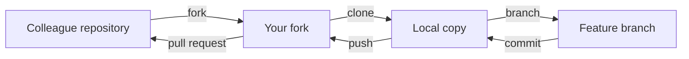

# Quick Reference

## Daily workflow

```bash
# Clone your fork
git clone https://github.com/YOUR-USERNAME/REPOSITORY.git
cd REPOSITORY

# Add the original repository
git remote add upstream https://github.com/colleague/REPOSITORY.git

# Create a working branch
git switch -c feature/my-change

# Stage and commit
git add .
git commit -m "Describe the change"

# Push to your fork
git push -u origin feature/my-change
```

## Synchronize `main`

```bash
git switch main
git fetch upstream
git merge upstream/main
git push origin main
```

## Remotes

| Name | Purpose | Example |
|---|---|---|
| `origin` | Your fork | `YOUR-USERNAME/REPOSITORY` |
| `upstream` | Colleague's original repository | `colleague/REPOSITORY` |

Check remotes:

```bash
git remote -v
```

## Pull request checklist

- [ ] Created on a dedicated branch
- [ ] Base repository is correct
- [ ] Base and compare branches are correct
- [ ] Changes are focused and documented
- [ ] Commits have clear messages
- [ ] Tests pass
- [ ] No secrets or private files are included
- [ ] Conflicts are resolved

## Visual Studio Code

Press **Ctrl+Shift+P**, then use:

- `Git: Clone`
- `Git: Add Remote...`
- `Git: Create Branch...`
- `Git: Pull`
- `Git: Push`
- `Git: Commit Staged`

## Concept map


