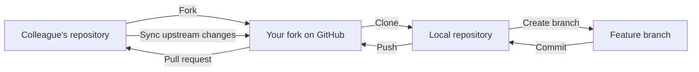

# Forking a GitHub Repository

A practical guide to creating a fork, cloning it in Visual Studio Code, making and pushing changes, syncing the original repository, and proposing work with a pull request.

## Quick definitions

| Action | What it does |
|---|---|
| **Fork** | Creates a copy of another user's repository under your GitHub account. |
| **Clone** | Downloads a repository to your local computer. |
| **Branch** | Creates an independent line of development for a change. |
| **Commit** | Records staged changes in local Git history. |
| **Push** | Uploads commits from your computer to GitHub. |
| **Pull request** | Proposes merging your changes into another repository. |
| **Sync** | Updates a fork with changes from its upstream repository. |

## Before you begin

- Create a GitHub account.
- Install Git.
- Install Visual Studio Code.
- Confirm the original repository URL.
- Ensure you have permission to view the repository.

## 1. Fork the repository

1. Sign in to GitHub.
2. Open the colleague's repository.
3. Select **Fork** in the upper-right area.
4. Choose your account as the **Owner**.
5. Keep or change the **Repository name**.
6. Add an optional description.
7. Select **Create fork**.

You now have a GitHub copy such as:

```text
Colleague: github.com/colleague/IoT-Project
Your fork: github.com/YOUR-USERNAME/IoT-Project
```

Forking does not change the original repository.

## 2. Clone the fork

### Visual Studio Code

1. Open your fork on GitHub.
2. Select **Code**.
3. Copy the HTTPS URL.
4. Open VS Code.
5. Press **Ctrl+Shift+P**.
6. Search for **Git: Clone**.
7. Paste the URL.
8. Choose a local folder.
9. Open the downloaded repository.

### Terminal

```bash
git clone https://github.com/YOUR-USERNAME/IoT-Project.git
cd IoT-Project
```

Use SSH only after configuring an SSH key:

```bash
git clone git@github.com:YOUR-USERNAME/IoT-Project.git
```

## 3. Configure the upstream repository

After cloning your fork, add the colleague's original repository as `upstream`:

```bash
git remote -v
git remote add upstream https://github.com/colleague/IoT-Project.git
git remote -v
```

Typical output includes:

- `origin`: points to your fork.
- `upstream`: points to the colleague's original repository.

## 4. Create a feature branch

Never develop directly on `main` when preparing a separate contribution:

```bash
git switch main
git pull origin main
git switch -c feature/my-change
```

Example branch names:

```text
feature/add-temperature-alert
fix/serial-port-error
docs/update-installation-guide
```

## 5. Edit, stage, commit, and push

Make your changes in VS Code, then return to the terminal:

```bash
git status
git add .
git commit -m "Describe the change"
git push -u origin feature/my-change
```

Guidelines for commits:

- Make each commit represent one logical change.
- Start the subject with a verb.
- Keep the subject below approximately 72 characters.
- Use a blank line and a longer explanation when necessary.

## 6. Open a pull request

1. Open your fork on GitHub.
2. GitHub will often offer **Compare & pull request**.
3. Confirm that the base repository is the colleague's original repository.
4. Confirm that the base branch is `main` or the requested target branch.
5. Confirm that the compare branch is your feature branch.
6. Add a clear title and summary.
7. Link relevant issues.
8. Submit the pull request.

Your pull request is a proposal. It does not merge automatically unless the repository owner enables automation and approves it.

## 7. Keep your fork synchronized

### Using GitHub

1. Open your fork.
2. Select **Sync fork**.
3. Choose **Update branch** if it is available.

### Using Git

```bash
git switch main
git fetch upstream
git merge upstream/main
git push origin main
```

To update a feature branch with the latest `main` changes:

```bash
git switch feature/my-change
git fetch upstream
git merge upstream/main
```

Resolve merge conflicts if Git reports them, then commit and push:

```bash
git add .
git commit -m "Resolve merge conflicts"
git push
```

## Workflow diagram



## Command reference

```bash
# Show repository status
git status

# Display remote repositories
git remote -v

# Create and switch to a branch
git switch -c feature/my-change

# Stage a file
git add filename

# Stage all changes
git add .

# Commit staged changes
git commit -m "Message"

# Push a branch and set its upstream
git push -u origin feature/my-change

# Push the current branch
git push

# Update remotes
git fetch upstream

# Switch branches
git switch branch-name

# See recent commits
git log --oneline --decorate -10

# See all branches
git branch -a
```

## Troubleshooting

### `Permission denied (publickey)`

The clone or push is probably using SSH. Use HTTPS instead:

```bash
git remote set-url origin https://github.com/YOUR-USERNAME/REPOSITORY.git
```

### `fatal: not a git repository`

Navigate to the folder containing the `.git` directory:

```bash
cd path/to/REPOSITORY
git status
```

### `rejected` or `non-fast-forward`

Fetch and merge remote changes before pushing:

```bash
git fetch origin
git merge origin/feature/my-change
git push
```

If the branch is your own feature branch, a rebase is also possible:

```bash
git pull --rebase origin feature/my-change
git push
```

### Merge conflict

Git has marked conflicting sections in affected files. In VS Code:

1. Open each conflicted file.
2. Choose **Accept Current Change**, **Accept Incoming Change**, or combine manually.
3. Remove conflict markers.
4. Save the file.
5. Stage it:

```bash
git add path/to/conflicted-file
```

6. Continue:

```bash
git commit
git push
```

For a merge, if needed:

```bash
git merge --abort
```

For a rebase:

```bash
git rebase --abort
```

### `upstream` already exists

Update its URL:

```bash
git remote set-url upstream https://github.com/colleague/REPOSITORY.git
```

### Changes appear in the fork, but not the original repository

This is expected. A push only updates a remote branch. The original repository only receives proposed changes after a pull request is created and merged.

## Security

- Never commit passwords, API keys, access tokens, or private certificates.
- If a secret is committed, rotate it immediately; deleting it in a later commit does not remove it from history.
- Review `.gitignore` before staging files.
- Use environment variables or a secrets manager for sensitive configuration.

## License

Add a LICENSE file before publishing reusable project content. On GitHub, **Add file > Create new file** can create one using the license template selector.
